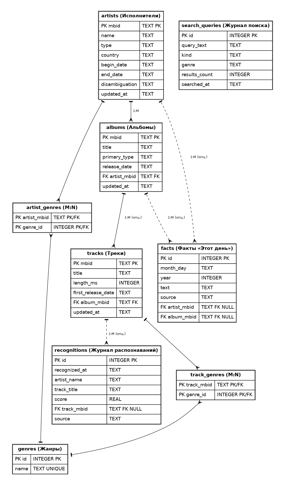

# Music Wiki

Музыкальная вики в стиле Windows XP на Flask: поиск песен и исполнителей
(MusicBrainz), биографии и похожие артисты (Last.fm), распознавание песни
по записи (AudD).

```bash
pip install -r requirements.txt
cp .env.example .env        # заполнить ключи (см. ниже)
python download_assets.py   # один раз: xp.css + иконки Silk в static/
flask --app app run --debug
```

- Факты «Этот день»: `data/on_this_day.json` (ключ ММ-ДД), пополняется вручную, перезапуск не нужен.
  Альбомы с открытых страниц артистов добавляются в базу фактов автоматически.
- Бегущая строка: `data/music_facts.json`.
- Цитаты в подсказке маскота: `services/quotes.py` (список `MUSIC_QUOTES`).
- Запись с микрофона работает только на https:// или http://localhost.

## База данных

Проект использует облачную базу **Supabase** (PostgreSQL + REST API PostgREST).

В `.env` задаются две переменные из Supabase Dashboard -> Project Settings -> API:

- `SUPABASE_URL` - адрес проекта;
- `SUPABASE_KEY` - ключ `service_role` (только для сервера, в браузер не попадает).

Схема создаётся один раз в **SQL Editor** Supabase файлом
[`db/supabase_schema.sql`](db/supabase_schema.sql). Таблицы:

- `artists`, `albums`, `tracks` - карточки MusicBrainz;
- `genres`, `artist_genres`, `track_genres` - жанры и связи M:N;
- `facts`, `release_dates` - факты «Этот день»;
- `recognitions`, `search_queries` - аналитика распознаваний и поиска;
- `cache` - технический key-value кэш ответов MusicBrainz / Last.fm / AudD.

Представления `top_searches` и `artists_album_counts` считают агрегаты на
стороне базы. Доступ к таблицам закрыт политиками RLS: приложение ходит под
`service_role`, а публичный ключ `anon` данные не видит.

Данные попадают в базу автоматически: при открытии страницы артиста или
трека, при поиске и при распознавании аудио.



## SEO

- `SITE_URL` в `.env` задает публичный адрес для canonical, `robots.txt` и `sitemap.xml`.
  По умолчанию стоит `https://example.com`, при публикации его нужно заменить.
- `/robots.txt` и `/sitemap.xml` отдает Flask. В sitemap попадают статические
  страницы и карточки артистов и треков из Supabase.
- Статика кэшируется, у изображений заданы размеры, GIF маскота облегчен.
- Итоги и скриншоты Lighthouse лежат в `docs/seo/`.

## Docker и CI/CD

```bash
docker build -t music-wiki .
docker run -p 5000:5000 --env-file .env music-wiki
```

Готовый образ публикуется GitHub Actions в GitHub Container Registry при каждом push в `main`:

```bash
docker pull ghcr.io/qwdxx012/music-wiki:latest
```

Workflow: `.github/workflows/build.yml` (задачи `test`, `docker`, `build`).

Локальный деплой с nginx, HTTPS и доменом `music-wiki.localhost` вынесен в
отдельный репозиторий
[music-wiki-deploy](https://github.com/qwdxx012/music-wiki-deploy): там лежат
`docker-compose.yml`, конфигурация nginx и отчет по практическому занятию.
