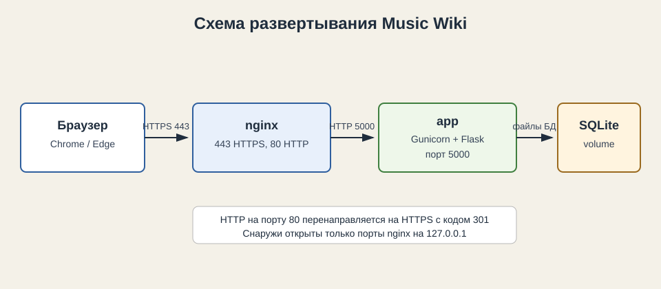
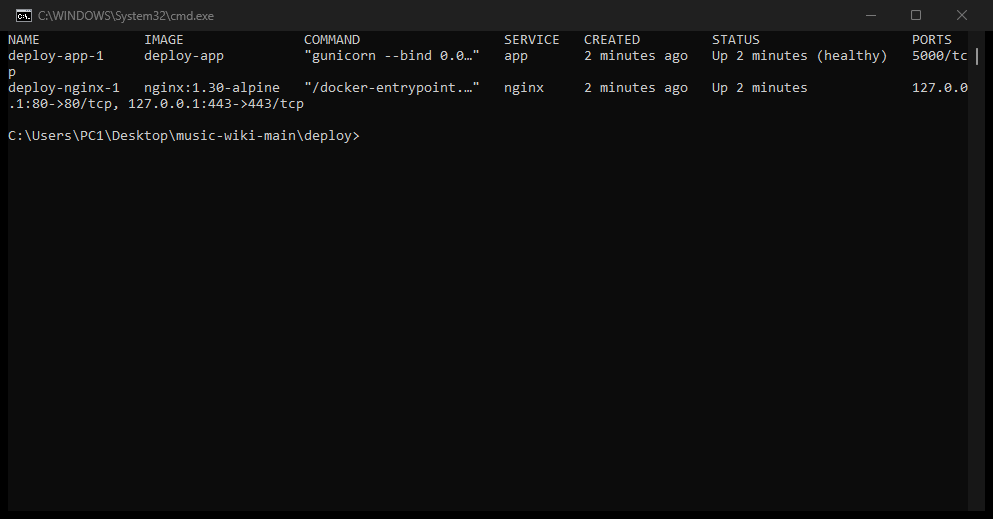
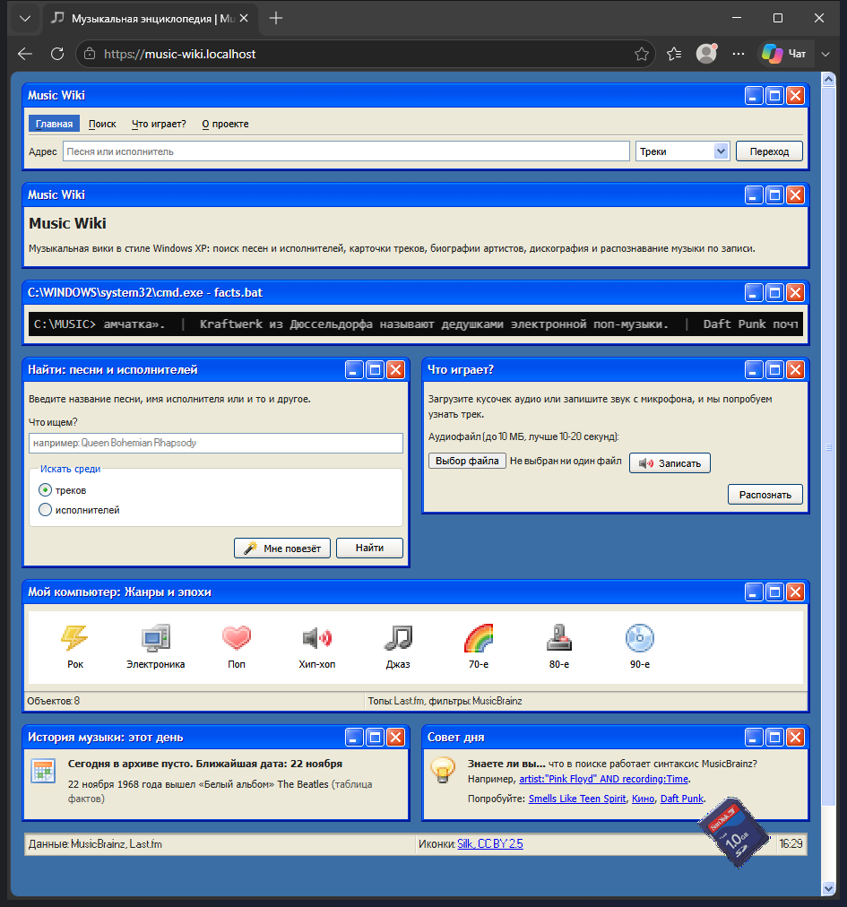
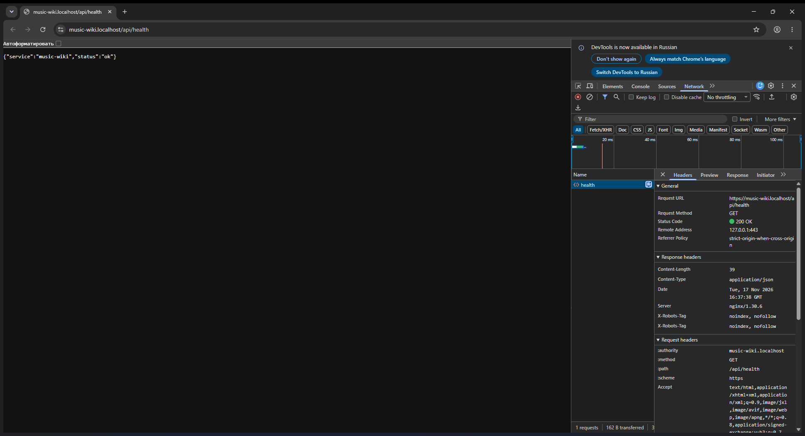
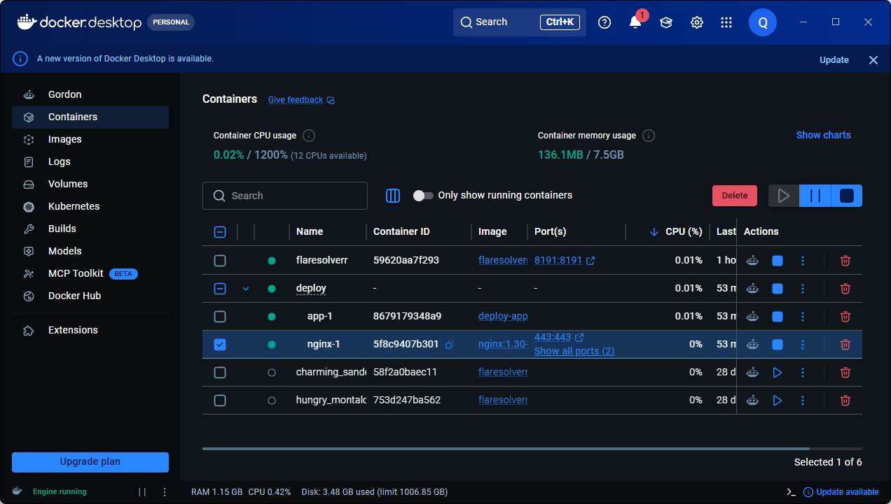

# Практическое занятие 18. Деплой приложения на выбранный хостинг: настройка серверов, SSL, домен, интеграция с CI/CD

Выполнил: Крамской Н.Д., группа ПР-25.106.

Вариант: индивидуальный проект Music Wiki.

## 1. Что развернуто

Music Wiki - веб-приложение на Flask. Приложение само формирует HTML, поэтому отдельного фронтенда нет. При развертывании получилось два сервиса:

- app - Flask под Gunicorn, внутренний порт 5000;
- nginx - единая точка входа, порты 80 и 443.

SQLite работает внутри контейнера app. Файлы базы лежат в томе `wiki_data`, поэтому данные не пропадают при пересоздании контейнера. Отдельного сервиса базы данных нет.

Схема развертывания:



Запрос идет по цепочке: браузер, nginx, приложение, SQLite. nginx принимает HTTPS на порту 443, а запросы по HTTP на порту 80 перенаправляет на HTTPS с кодом 301. Снаружи открыты только порты nginx, причем только на `127.0.0.1`. Поэтому сайт доступен только с этого компьютера.

## 2. Сервисы проекта

| Сервис | Технология | Внутренний порт | Продакшен-сервер |
| --- | --- | --- | --- |
| app | Flask + Gunicorn | 5000 | Gunicorn |
| nginx | nginx 1.30 | 80, 443 | - |

SQLite не является отдельным сервисом. База работает внутри контейнера app, а файлы хранятся в томе `wiki_data`.

## 3. Переменные окружения и секреты

Значения хранятся в файле `.env` в корне проекта. Этот файл не попадает в git и не копируется в Docker-образ.

Переменные:

- `SECRET_KEY` - секрет;
- `LASTFM_API_KEY` - секрет;
- `AUDD_API_TOKEN` - секрет;
- `MB_CONTACT` - контакт для MusicBrainz, не секрет;
- `SITE_URL` - публичный адрес сайта, не секрет.

В `docker-compose.yml` адрес `SITE_URL` задан как `https://music-wiki.localhost`. Ключи передаются контейнеру при запуске через `env_file`, а не записываются в образ.

## 4. Запуск и остановка

Перед первым запуском из корня проекта создайте файл `.env` из `.env.example` и заполните ключи. Файл `.env` в git не попадает.

```bash
cp .env.example .env
```

Все остальные команды выполняются из папки `deploy`.

```bash
docker compose up --build -d
docker compose ps
docker compose logs app
docker compose down
```

После запуска проект открывается по адресу:

```text
https://music-wiki.localhost
```

Домен `music-wiki.localhost` не нужно регистрировать. Имена вида `*.localhost` зарезервированы стандартом RFC 6761 и направляются на этот же компьютер. Браузеры Chrome и Edge понимают такие имена без правки файла hosts.

## 5. Скриншоты

Вывод `docker compose ps`:



Страница проекта по адресу `https://music-wiki.localhost` с замком в адресной строке:



Вкладка Network с запросом `/api/health` и заголовками ответа. Виден заголовок `X-Robots-Tag: noindex, nofollow`:



Контейнеры проекта в Docker Desktop:



## 6. Что изменено в проекте

- В `app.py` добавлен `ProxyFix`. nginx передает заголовки `X-Forwarded-For`, `X-Forwarded-Proto` и `X-Forwarded-Host`, а Flask должен правильно понимать исходный домен и протокол.
- Добавлен служебный маршрут `GET /api/health`. Он возвращает JSON `{"status": "ok", "service": "music-wiki"}` и используется для проверки контейнера и показа заголовка `X-Robots-Tag`.
- В `Dockerfile` добавлен пользователь `appuser`. Приложение запускается не от root. Папка `/app/instance` принадлежит этому пользователю, потому что туда пишутся базы SQLite.
- В `.dockerignore` добавлена папка `deploy/`, чтобы сертификаты и файлы отчета не попадали в образ.
- Созданы `deploy/docker-compose.yml`, `deploy/nginx/nginx.conf` и `deploy/.gitignore`.
- В nginx добавлены gzip, перенаправление HTTP на HTTPS, заголовки `X-Forwarded-*`, `X-Robots-Tag` для `/api/` и ограничение размера запроса `client_max_body_size 12m`. Ограничение нужно, потому что приложение принимает аудиофайлы до 10 МБ.
- Заголовок `X-Robots-Tag` для JSON-ответов также добавляет Flask после SEO-задания. Поэтому в ответе `/api/health` он может быть указан дважды. Это не ошибка: nginx и приложение дополняют друг друга.
- В GitHub Actions добавлена проверка сборки Docker-образа и валидация `docker-compose.yml`.

## 7. Ошибки и способы устранения

1. Docker Desktop был установлен, но не запущен. При обращении к Docker появлялась ошибка про `npipe:////./pipe/dockerDesktopLinuxEngine`. Запустил Docker Desktop и дождался, пока движок начнет отвечать.

2. Утилита mkcert не была установлена, а winget на компьютере недоступен. Для локального HTTPS использовал OpenSSL: создал локальный центр сертификации `Music Wiki Local CA` и выпустил сертификат для `music-wiki.localhost`. Корневой сертификат добавил в хранилище доверенных сертификатов текущего пользователя. Результат тот же, что у mkcert: браузер показывает замок и не показывает предупреждение.

3. В Microsoft Edge при запуске DevTools открывалась приветственная вкладка, и переключить ее на панель Network не удалось. Открыл проект в Google Chrome, включил DevTools, перешел на вкладку Network и выбрал запрос `/api/health`. В заголовках ответа виден `X-Robots-Tag: noindex, nofollow`.

4. В Docker Desktop группа `deploy` показана свернутой. Порты контейнеров хорошо видны на скриншоте `docker compose ps`: у app только внутренний порт 5000, у nginx опубликованы `127.0.0.1:80` и `127.0.0.1:443`.

5. При первом запуске контейнера нужно было проверить права на папку `/app/instance`. В Dockerfile папка создается и передается пользователю `appuser`, поэтому SQLite смог создать базы. Внутри контейнера файлы принадлежат `appuser:appuser`.

## 8. Что нужно изменить для публикации на реальном сервере

Для настоящей публикации нужно арендовать сервер или облачный хостинг, установить Docker и Docker Compose, зарегистрировать домен и создать A-запись, которая указывает на IP сервера. Затем нужно открыть порты 80 и 443, получить настоящий сертификат Let's Encrypt через Certbot, заменить локальные сертификаты и имя `music-wiki.localhost` на реальный домен в `nginx.conf` и `SITE_URL`. Секреты нужно хранить в GitHub Secrets или в хранилище секретов, а не в репозитории. Для SQLite нужен постоянный том или отдельная база данных. Дополнительно настраиваются резервное копирование, мониторинг и автоматическая доставка образа на сервер.

## 9. CI/CD

Workflow `.github/workflows/build.yml` запускается при push, pull request и вручную. Он выполняет тесты, проверяет `docker-compose.yml` и собирает Docker-образ приложения. При push в `main` образ дополнительно публикуется в GitHub Container Registry и проходит smoke-тест. Это обязательная проверка сборки и дополнительная доставка образа, как в задании.

Перед отправкой работы файлы `.env`, ключи и папка `deploy/certs/` не должны попадать в репозиторий. Папка `deploy/certs/` уже добавлена в `deploy/.gitignore`.
