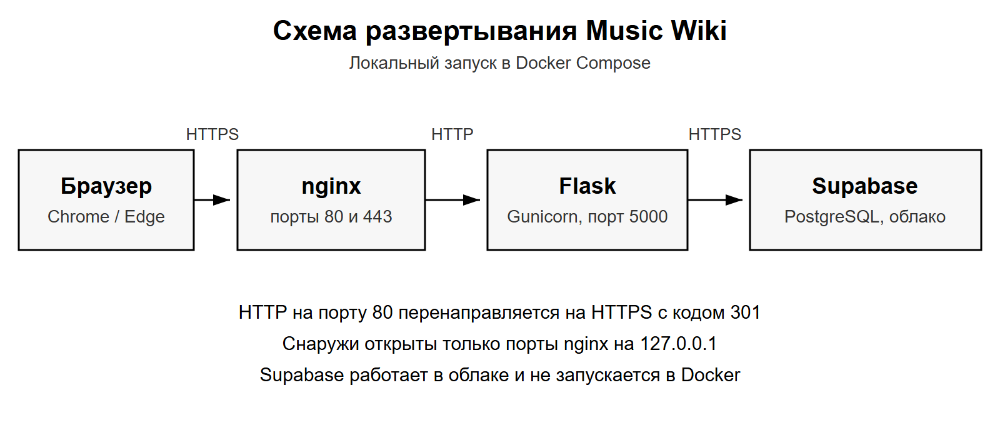
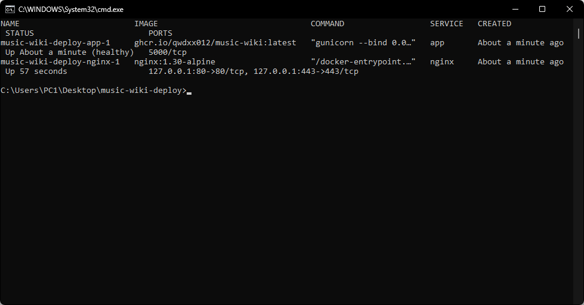
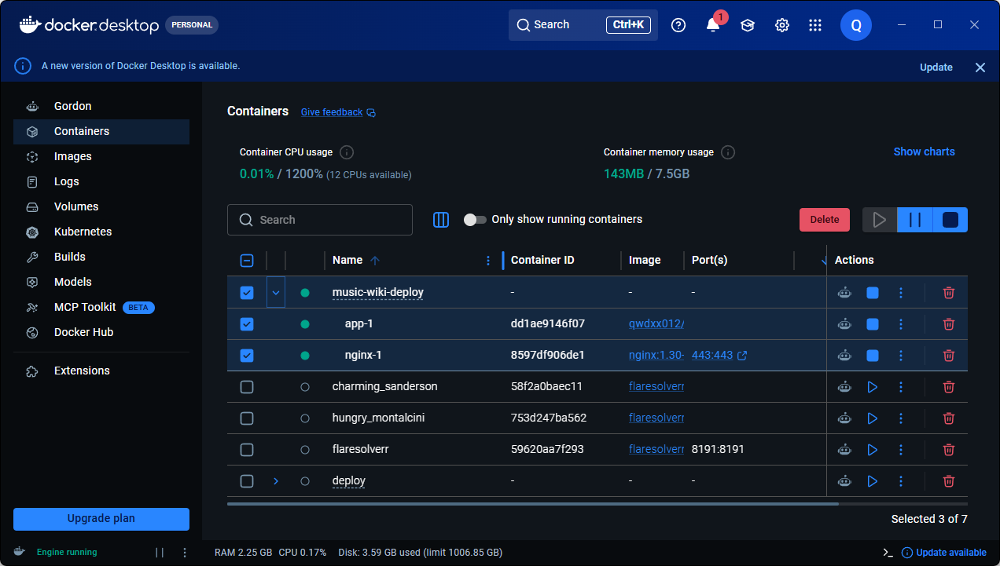

# Практическое занятие 18. Деплой приложения на выбранный хостинг: настройка серверов, SSL, домен, интеграция с CI/CD

Выполнил: Крамской Н.Д., группа ПР-25.106.

Вариант: индивидуальный проект Music Wiki.

Репозиторий приложения: https://github.com/qwdxx012/music-wiki

Репозиторий деплоя: https://github.com/qwdxx012/music-wiki-deploy

## 1. Что развернуто

Music Wiki - веб-приложение на Flask. Приложение само формирует HTML, поэтому отдельного фронтенда нет. При развертывании получилось два контейнера:

- app - Flask под Gunicorn, внутренний порт 5000;
- nginx - единая точка входа, порты 80 и 443.

База данных работает в облаке Supabase (PostgreSQL). Приложение обращается к ней по HTTPS через REST API PostgREST. Отдельного контейнера базы нет, файлы базы внутри Docker не хранятся. Схема таблиц лежит в репозитории приложения: `db/supabase_schema.sql`.

Схема развертывания:



Запрос идет по цепочке: браузер, nginx, приложение, Supabase. nginx принимает HTTPS на порту 443, а запросы по HTTP на порту 80 перенаправляет на HTTPS с кодом 301. Снаружи открыты только порты nginx, причем только на `127.0.0.1`. Поэтому сайт доступен только с этого компьютера.

## 2. Сервисы проекта

| Сервис | Технология | Внутренний порт | Продакшен-сервер |
| --- | --- | --- | --- |
| app | Flask + Gunicorn | 5000 | Gunicorn |
| nginx | nginx 1.30 | 80, 443 | - |
| Supabase | PostgreSQL, REST API | - | облако Supabase |

Supabase - внешний managed-сервис. Он не запускается в Docker Compose, поэтому в списке контейнеров его нет. Приложение подключается к проекту Supabase по `SUPABASE_URL` и ключу `service_role`.

## 3. Переменные окружения и секреты

Значения хранятся в файле `.env` в корне репозитория деплоя. Этот файл не попадает в git и не копируется в Docker-образ.

Переменные:

- `SECRET_KEY` - секрет;
- `LASTFM_API_KEY` - секрет;
- `AUDD_API_TOKEN` - секрет;
- `SUPABASE_URL` - адрес проекта Supabase, не секрет;
- `SUPABASE_KEY` - ключ `service_role`, секрет;
- `MB_CONTACT` - контакт для MusicBrainz, не секрет;
- `SITE_URL` - публичный адрес сайта, не секрет.

В `docker-compose.yml` адрес `SITE_URL` задан как `https://music-wiki.localhost`. Остальные значения передаются контейнеру при запуске через `env_file`, а не записываются в образ. Ключ `service_role` обходит политики RLS, поэтому он хранится только на сервере и не попадает в браузер.

## 4. Запуск и остановка

Перед первым запуском создайте файл `.env` в корне репозитория деплоя и заполните ключи. Файл `.env` в git не попадает.

Docker-образ приложения собирается и публикуется в GitHub Actions репозитория `music-wiki`. Для локальной проверки его можно собрать вручную из исходников приложения:

```bash
cd music-wiki
docker build -t ghcr.io/qwdxx012/music-wiki:latest .
```

Все остальные команды выполняются из папки с `docker-compose.yml`:

```bash
docker compose pull
docker compose up -d
docker compose ps
docker compose logs app
docker compose down
```

Если пакет в GHCR закрыт, перед `docker compose pull` выполните `docker login ghcr.io`.

После запуска проект открывается по адресу:

```text
https://music-wiki.localhost
```

Домен `music-wiki.localhost` не нужно регистрировать. Имена вида `*.localhost` зарезервированы стандартом RFC 6761 и направляются на этот же компьютер. Браузеры Chrome и Edge понимают такие имена без правки файла hosts.

## 5. Скриншоты

Вывод `docker compose ps`:



Страница проекта по адресу `https://music-wiki.localhost` с замком в адресной строке:


Вкладка Network с запросом `/api/health` и заголовками ответа. Виден заголовок `X-Robots-Tag: noindex, nofollow`:


Контейнеры проекта в Docker Desktop. Группа `music-wiki-deploy` раскрыта, в колонке Port(s) у nginx видны открытые порты:



## 6. Что изменено в проекте

- Приложение работает с облачной базой Supabase. В `config.py` заданы `SUPABASE_URL` и `SUPABASE_KEY`, в `services/store.py` и `services/cache.py` запросы идут через Supabase REST API.
- Схема `db/supabase_schema.sql` создает таблицы `artists`, `albums`, `tracks`, `genres`, `facts`, `release_dates`, `recognitions`, `search_queries`, `cache` и представления для аналитики. Для таблиц включен RLS, приложение работает под ролью `service_role`.
- В `app.py` добавлен `ProxyFix`. nginx передает заголовки `X-Forwarded-For`, `X-Forwarded-Proto` и `X-Forwarded-Host`, а Flask должен правильно понимать исходный домен и протокол.
- Добавлен служебный маршрут `GET /api/health`. Он возвращает JSON `{"status": "ok", "service": "music-wiki"}` и используется для проверки контейнера и показа заголовка `X-Robots-Tag`.
- В `Dockerfile` добавлен пользователь `appuser`, приложение запускается не от root. Отдельная папка для файлов базы не создается: база вынесена в Supabase.
- Созданы `docker-compose.yml`, `nginx/nginx.conf` и `.gitignore`. В compose приложение запускается из готового образа GHCR, рядом работает nginx.
- В nginx добавлены gzip, перенаправление HTTP на HTTPS, заголовки `X-Forwarded-*`, `X-Robots-Tag` для `/api/` и ограничение размера запроса `client_max_body_size 12m`. Ограничение нужно, потому что приложение принимает аудиофайлы до 10 МБ.
- Заголовок `X-Robots-Tag` для JSON-ответов также добавляет Flask. Поэтому в ответе `/api/health` он может быть указан дважды. Это не ошибка: nginx и приложение дополняют друг друга.
- В GitHub Actions репозитория приложения собирается и публикуется Docker-образ.

## 7. Ошибки и способы устранения

1. Docker Desktop был установлен, но не запущен. При обращении к Docker появлялась ошибка про `npipe:////./pipe/dockerDesktopLinuxEngine`. Запустил Docker Desktop и дождался, пока движок начнет отвечать.

2. Утилита mkcert не была установлена, а winget на компьютере недоступен. Для локального HTTPS использовал OpenSSL: создал локальный центр сертификации `Music Wiki Local CA` и выпустил сертификат для `music-wiki.localhost`. Корневой сертификат добавил в хранилище доверенных сертификатов текущего пользователя. Результат тот же, что у mkcert: браузер показывает замок и не показывает предупреждение.

3. Для healthcheck контейнера нужен был адрес, который отвечает без обращения к внешним API. Добавил маршрут `GET /api/health`, а в `docker-compose.yml` прописал проверку через `python urllib`. nginx стартует только после того, как app станет healthy.

4. После подключения Supabase приложение получало ошибку `PGRST205: Could not find the table 'public.artists' in the schema cache`. Таблицы еще не были созданы. Выполнил `db/supabase_schema.sql` в Supabase Dashboard → SQL Editor и перезагрузил схему командой `notify pgrst, 'reload schema'`. После этого запросы к таблицам заработали.

5. При работе с Supabase важно не перепутать ключи. Публичный ключ `anon` не дает доступа к таблицам из-за RLS, поэтому в `.env` указан ключ `service_role`. Он используется только сервером и не передается в браузер.

## 8. Что нужно изменить для публикации на реальном сервере

Для настоящей публикации нужно арендовать сервер или облачный хостинг, установить Docker и Docker Compose, зарегистрировать домен и создать A-запись, которая указывает на IP сервера. Затем нужно открыть порты 80 и 443, получить настоящий сертификат Let's Encrypt через Certbot, заменить локальные сертификаты и имя `music-wiki.localhost` на реальный домен в `nginx.conf` и `SITE_URL`. Секреты нужно хранить в GitHub Secrets или в хранилище секретов, а не в репозитории. Supabase остается облачным сервисом: переносить базу на сервер не нужно, достаточно указать боевой проект в `.env`. Дополнительно настраиваются резервное копирование, мониторинг и автоматическая доставка образа на сервер.

## 9. CI/CD

В репозитории приложения workflow `.github/workflows/build.yml` запускается при push, pull request и вручную. Он выполняет тесты, собирает Docker-образ и при push в `main` публикует его в GitHub Container Registry. После публикации выполняется smoke-тест контейнера по адресу `/api/health`.

Перед отправкой работы файлы `.env`, ключи и сертификаты не должны попадать в репозиторий. Содержимое папки `certs/` добавлено в `.gitignore`, в git хранится только `certs/.gitkeep`.
