# Практическое занятие 20. SEO и аналитика

Выполнил: Крамской Н.Д., группа ПР-25.106  
Вариант: индивидуальный проект Music Wiki  
Адрес локального продакшена: https://music-wiki.localhost  
Ссылка на репозиторий: [github.com/qwdxx012/music-wiki](https://github.com/qwdxx012/music-wiki), папка `docs/audit`

Аудит проводился на версии проекта, запущенной через Docker Compose, а не на сервере разработки. Перед замерами Docker Desktop был запущен, контейнеры `app` и `nginx` работали. Проверки выполнялись в окне инкогнито, чтобы не влияли расширения браузера и сохраненные данные.

## 1. Страницы проекта

| Страница | Тип страницы | Как проверялась | Категории Lighthouse |
|---|---|---|---|
| `/` | публичная, есть в sitemap.xml | инкогнито, 3 запуска | все 4 |
| `/about` | публичная, есть в sitemap.xml | инкогнито, 3 запуска | все 4 |
| `/recognize` | публичная, есть в sitemap.xml | инкогнито, 3 запуска | все 4 |
| `/artist/<mbid>` | публичная, есть в sitemap.xml | инкогнито, 3 запуска | все 4 |
| `/track/<mbid>` | публичная, есть в sitemap.xml | инкогнито, 3 запуска | все 4 |
| `/search?q=Queen` | noindex, нет в sitemap.xml | инкогнито, 3 запуска | без SEO |
| `/random` | noindex, служебная | инкогнито, 3 запуска | без SEO |
| `/api/health` | служебный JSON | не проверялась в Lighthouse | - |

Страниц, доступных только после входа, в проекте нет: авторизация не используется. У страниц `/search` и `/random` в HTML стоит `noindex, nofollow`, поэтому SEO-категория Lighthouse для них не проверялась.

Для проверки динамических страниц были открыты реальные карточки из результатов поиска: `Baby Ranks` и `Queen Street Queen`. После этого они сохранились в Supabase и попали в sitemap.xml. Еще одна карточка трека появилась после проверки распознавания через AudD. Она использует тот же шаблон, что и измеренная карточка трека, поэтому отдельно в Lighthouse не запускалась. В sitemap сейчас шесть адресов: `/`, `/about`, `/recognize`, карточка артиста и две карточки треков.

## 2. Результаты Lighthouse

Lighthouse 10.4.0, режим Navigation, Desktop, все четыре категории. Каждый запуск выполнялся в чистой сессии браузера. Для страниц сделано по три запуска. В каждой ячейке указаны оценки всех трех запусков и медиана.

| Страница | Performance | Accessibility | Best Practices | SEO |
|---|---|---|---|---|
| `/` | 100, 100, 100 (медиана 100) | 100, 100, 100 (медиана 100) | 100, 100, 100 (медиана 100) | 100, 100, 100 (медиана 100) |
| `/about` | 100, 100, 100 (медиана 100) | 100, 100, 100 (медиана 100) | 100, 100, 100 (медиана 100) | 100, 100, 100 (медиана 100) |
| `/recognize` | 100, 100, 100 (медиана 100) | 100, 100, 100 (медиана 100) | 100, 100, 100 (медиана 100) | 100, 100, 100 (медиана 100) |
| `/artist/<mbid>` | 100, 100, 100 (медиана 100) | 98, 98, 98 (медиана 98) | 100, 100, 100 (медиана 100) | 100, 100, 100 (медиана 100) |
| `/artist/<mbid>` после исправления | 100 | 100 | 100 | 100 |
| `/track/<mbid>` | 79, 100, 100 (медиана 100) | 100, 100, 100 (медиана 100) | 100, 100, 100 (медиана 100) | 100, 100, 100 (медиана 100) |
| `/search?q=Queen` | 100, 100, 100 (медиана 100) | 100, 100, 100 (медиана 100) | 100, 100, 100 (медиана 100) | не проверялась (noindex) |
| `/random` | 100, 100, 100 (медиана 100) | 100, 100, 100 (медиана 100) | 100, 100, 100 (медиана 100) | не проверялась (noindex) |

Для строки `/artist/<mbid>` после исправления выполнен один контрольный запуск, поэтому медиана не рассчитывалась.

Отчеты сохранены в папке `docs/audit/reports/`:

- [home.html](reports/home.html)
- [about.html](reports/about.html)
- [recognize.html](reports/recognize.html)
- [artist.html](reports/artist.html)
- [track.html](reports/track.html)
- [search.html](reports/search.html)
- [random.html](reports/random.html)
- [artist-after.html](reports/artist-after.html) - повторный замер после исправления Accessibility
- [after-home.html](reports/after-home.html) - повторный замер после исправления robots.txt

### Метрики Performance

Значения взяты из запуска, оценка которого совпала с медианой.

| Страница | FCP | LCP | TBT | CLS | Speed Index |
|---|---:|---:|---:|---:|---:|
| `/` | 0,3 с | 0,5 с | 0 мс | 0 | 0,4 с |
| `/about` | 0,3 с | 0,5 с | 0 мс | 0 | 0,3 с |
| `/recognize` | 0,3 с | 0,5 с | 0 мс | 0 | 0,3 с |
| `/artist/<mbid>` | 0,3 с | 0,5 с | 0 мс | 0 | 0,4 с |
| `/track/<mbid>` | 0,3 с | 0,6 с | 0 мс | 0 | 0,5 с |
| `/search?q=Queen` | 0,3 с | 0,5 с | 0 мс | 0 | 0,5 с |
| `/random` | 0,3 с | 0,5 с | 0 мс | 0 | 0,4 с |

У страницы трека один запуск дал Performance 79 и LCP 4,1 с. Это было связано с загрузкой внешней обложки с Last.fm. Два других запуска дали 100, поэтому медиана равна 100. Этот случай записан в таблицу проблем.

До исправления у страницы артиста Accessibility была 98 во всех трех запусках. После добавления доступного имени прогресс-бара контрольный запуск дал 100, поэтому по медиане все страницы получили 100 баллов.

## 3. Core Web Vitals вживую

Живые метрики снимались в Chrome DevTools, вкладка Performance, в окне инкогнито. На главной странице был выполнен основной сценарий: ввод названия исполнителя в поле поиска и переключение типа поиска. На странице распознавания было открыто окно выбора файла и отменено, чтобы получить реальное взаимодействие с формой.

Порог оценки «хорошо»: LCP не больше 2,5 с, INP не больше 200 мс, CLS не больше 0,1.

| Страница | LCP | Оценка LCP | INP | Оценка INP | CLS | Оценка CLS |
|---|---:|---|---:|---|---:|---|
| `/` | 0,33 с | хорошо | 24 мс | хорошо | 0,00 | хорошо |
| `/recognize` | 0,08 с | хорошо | 8 мс | хорошо | 0,00 | хорошо |

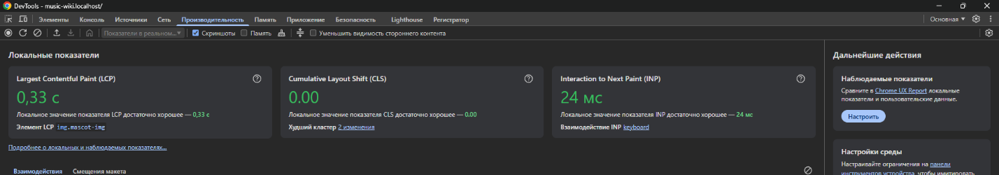

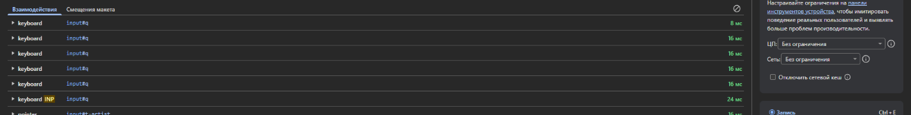

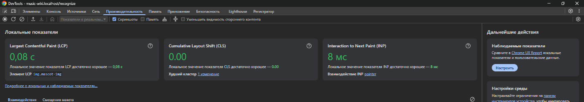

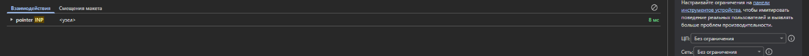

Значения INP в таблице - это время самого долгого взаимодействия из раздела Interactions. На главной странице это была работа с полем `input#q`, на странице распознавания - нажатие на кнопку выбора файла.

## 4. Ручные проверки

| Проверка | Страницы | Результат | Комментарий |
|---|---|---|---|
| `lang` у `<html>` | все | есть | `lang="ru"` |
| Тег `<title>` | все | есть | у каждой страницы свой заголовок |
| Метатег description | все публичные страницы | есть | описание соответствует странице |
| Содержимое в исходном HTML | все | есть | Flask и Jinja2 отдают готовый HTML |
| Метатег noindex | `/search`, `/random`, страницы ошибок | есть | `noindex, nofollow` |
| Атрибут alt у картинок | все | есть | у декоративных иконок `alt=""`, у содержательных картинок есть текст |
| Файл robots.txt | - | есть | открывается, адрес sitemap.xml указан |
| Файл sitemap.xml | - | есть | 6 адресов, все открываются |
| Навигация с клавиатуры | `/` | работает | фокус виден, Tab обходит ссылки, поля и кнопки |
| Мобильный вид | `/` | работает | при ширине 400 px страница перестраивается в одну колонку |

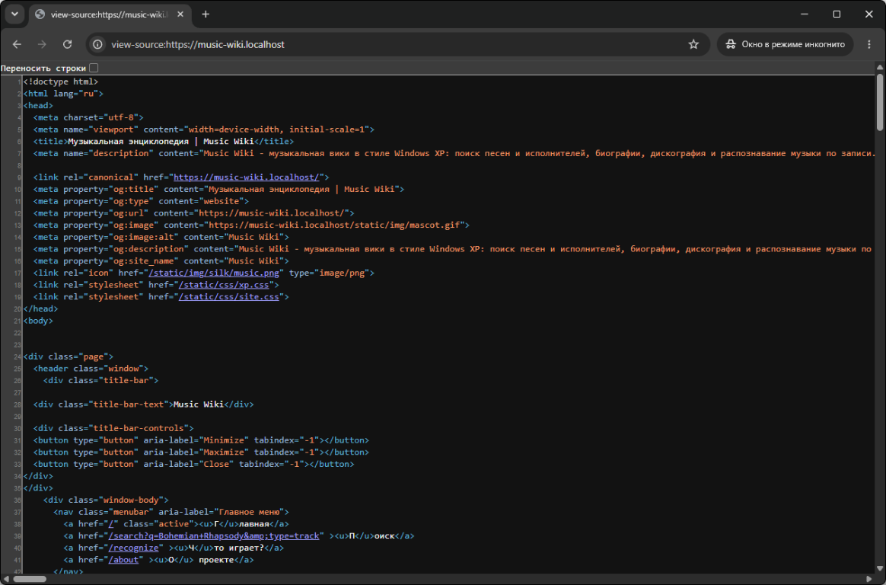

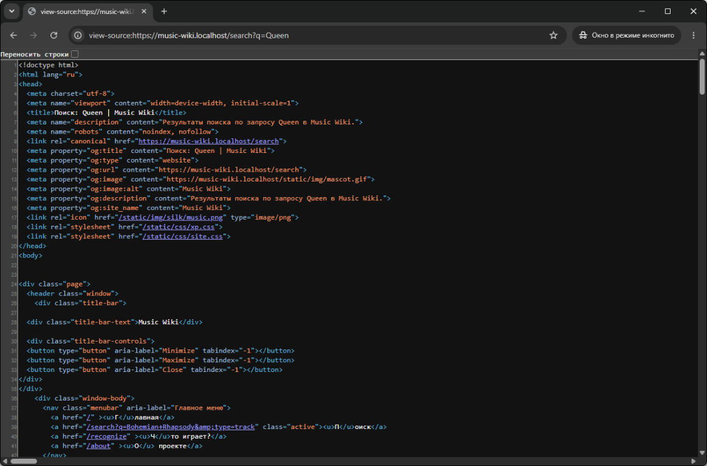

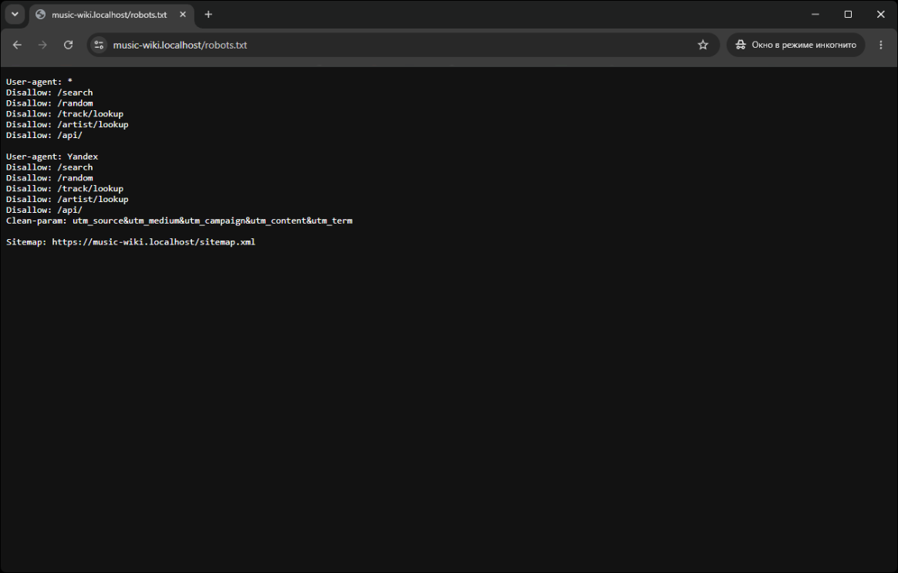

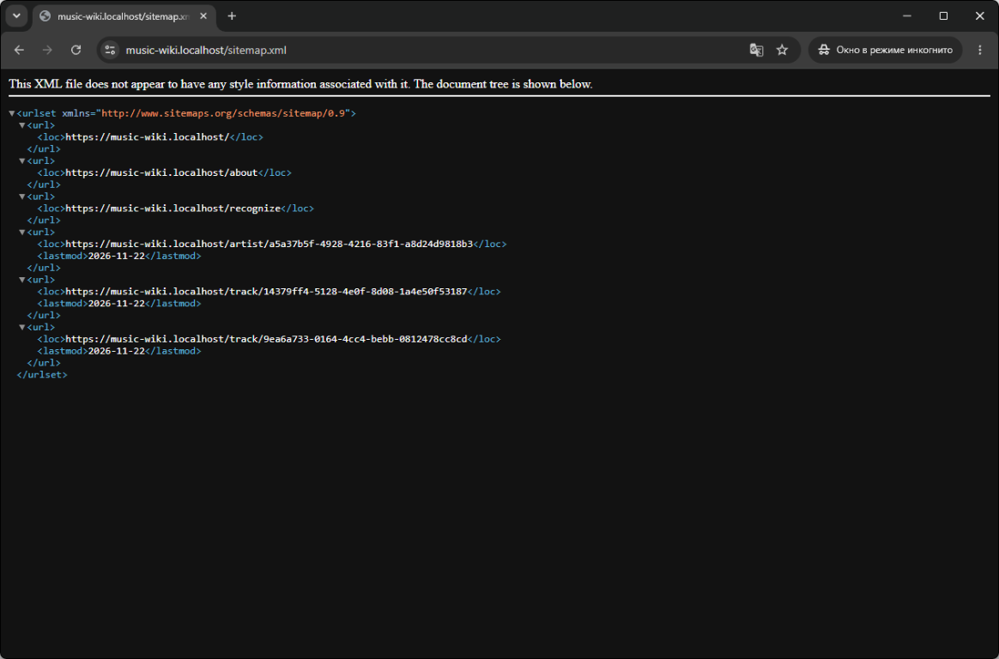

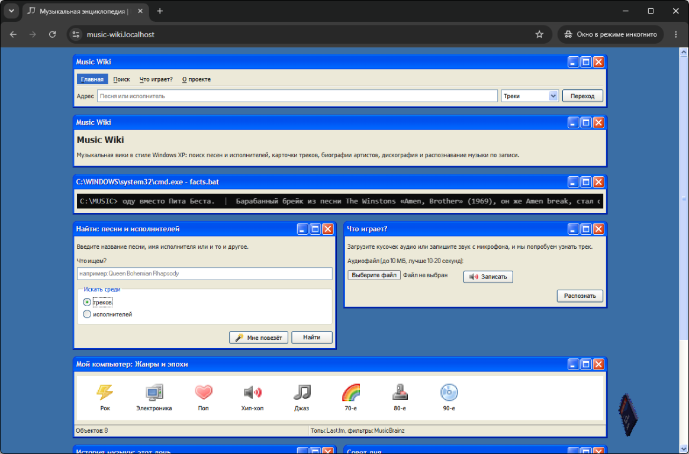

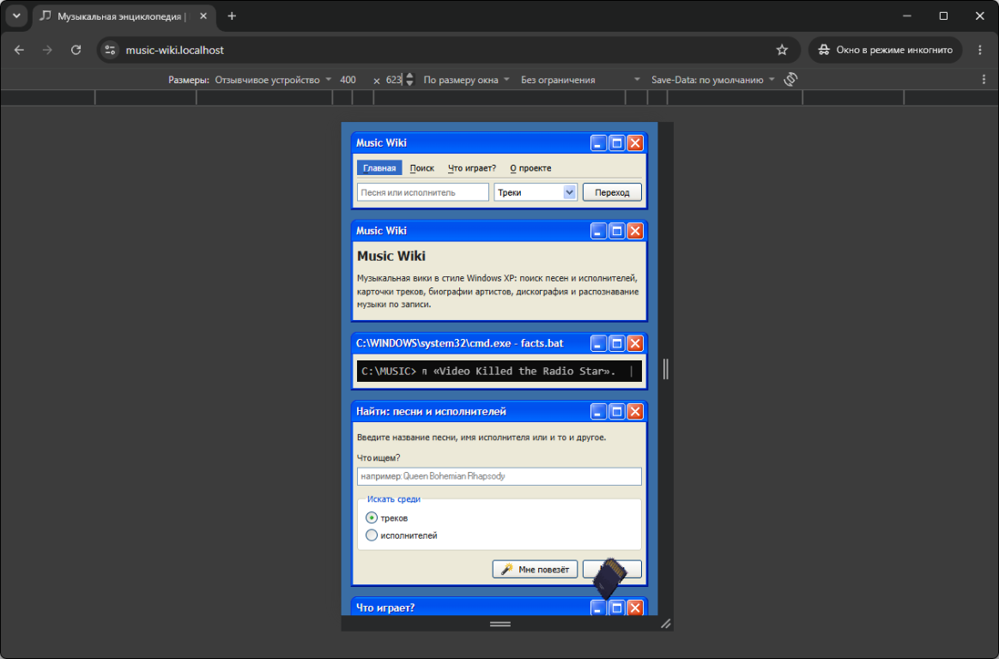

Проверка `robots.txt` и `sitemap.xml` показала, что все адреса из sitemap открываются и не закрыты в robots.txt. Адреса `/search` и `/random` в sitemap.xml не входят, это правильно: они не являются публичными страницами.

На всех скриншотах не видны имя, почта и адрес пользователя: проверки выполнялись в окне инкогнито, данные профиля в кадр не попадают.

## 5. Сравнение с замерами до и после занятия 70-71

На занятии 70-71 SEO-проверка главной страницы дала 90 баллов. В отчете Lighthouse было замечание «Document does not have a meta description». После добавления описания оценка SEO стала 100.

| Этап | SEO | Что изменилось |
|---|---:|---|
| До (`docs/seo/before.png`) | 90 | не было метатега description |
| После (`docs/seo/after.png`) | 100 | добавлены title и description |
| Текущий аудит | 100 | дополнительно проверены все четыре категории |

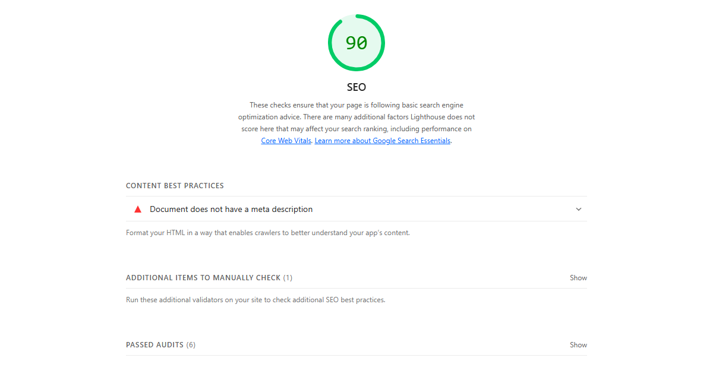

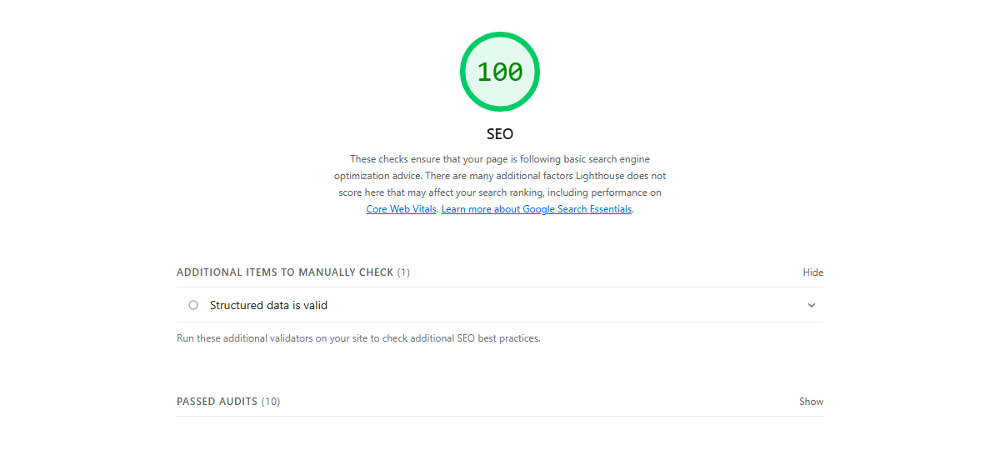

## 6. Сравнение с сайтом-аналогом

Для сравнения выбран сайт Last.fm (https://www.last.fm/), потому что это популярный музыкальный сервис с полевыми данными в CrUX. Проверка выполнена в PageSpeed Insights в режиме «Мобильные устройства».

| Показатель | Music Wiki, локальные данные, Desktop | Last.fm, полевые данные, мобильные | Last.fm, Lighthouse, мобильные |
|---|---:|---:|---:|
| LCP | 0,33 с (живые метрики) | 2,3 с | 2,7 с |
| INP | 24 мс (живые метрики) | 173 мс | - |
| CLS | 0,00 | 0,1 | 0,108 |
| Performance | 100 | - | 60 |
| Accessibility | 100 | - | 96 |
| Best Practices | 100 | - | 73 |
| SEO | 100 | - | 85 |

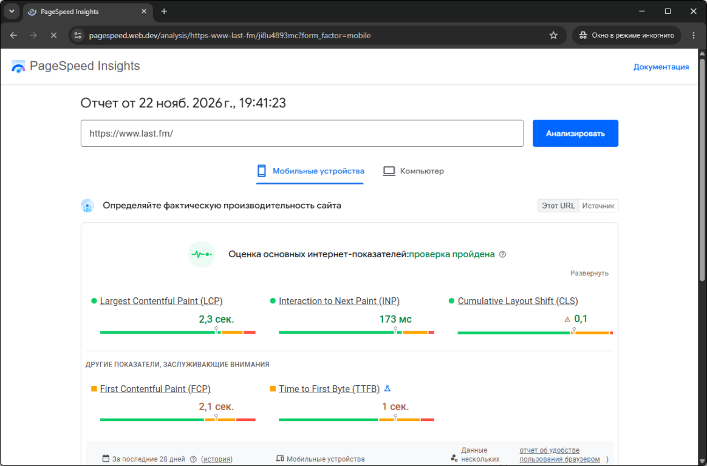

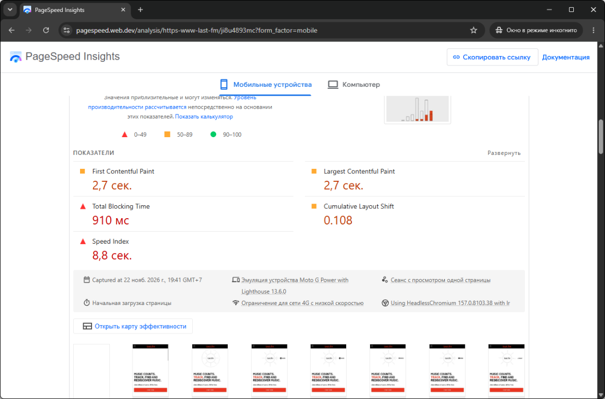

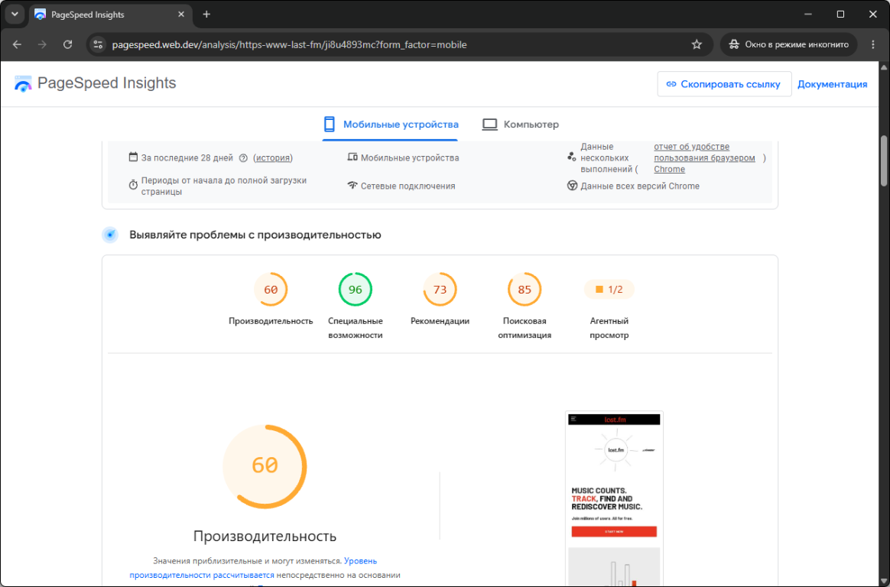

Выводы:

1. У Last.fm CLS равен 0,1, а у Music Wiki - 0,00. Значит, на страницах проекта элементы не сдвигаются при загрузке.
2. У Last.fm полевые значения LCP и INP хорошие, но лабораторная оценка Performance всего 60 из-за TBT 910 мс и Speed Index 8,8 с. У Music Wiki локальные метрики лучше, но сравнивать их напрямую нельзя: проект проверялся на Desktop и на локальном сервере, а Last.fm - на эмулированном мобильном устройстве с медленной сетью.
3. Last.fm получил в мобильном Lighthouse 96 за Accessibility, 73 за Best Practices и 85 за SEO. У Music Wiki все четыре категории по 100, но это лабораторные данные на мощном компьютере, а не полевые данные реальных пользователей.

## 7. Найденные проблемы и приоритеты

| Проблема | Страница | Влияние | Сложность | Приоритет | Как исправить | Статус |
|---|---|---|---|---|---|---|
| Прогресс-бар совпадения не имеет доступного имени | `/artist/<mbid>` | среднее | низкая | 1 | добавить `aria-label` к элементу `role="progressbar"` | исправлено |
| `/search` и `/random` одновременно закрыты в robots.txt и помечены `noindex` | `/search`, `/random` | среднее | низкая | 2 | убрать эти пути из `Disallow`, оставить `noindex` | исправлено |
| Страница трека не сохранялась в БД из-за внешнего ключа на альбом, поэтому не попадала в sitemap | `/track/<mbid>` | среднее | низкая | 3 | сохранять трек без ссылки на альбом, если альбома еще нет в таблице | исправлено |
| Один запуск трека дал LCP 4,1 с из-за внешней обложки Last.fm | `/track/<mbid>` | среднее | высокая | 4 | кэшировать или проксировать обложки на своей стороне | не исправлено |

Проблем с оценками Lighthouse по медиане, метатегами, alt, адаптивностью и клавиатурной навигацией не найдено. Скорость на локальном стенде у публичных страниц 100 баллов.

## 8. Что исправлено

### 8.1. robots.txt и noindex

До исправления `robots.txt` закрывал `/search` и `/random`, но эти страницы отдают метатег `noindex`. Поисковый робот не сможет прочитать `noindex`, если страница закрыта в `robots.txt`. Я убрал `/search` и `/random` из директив `Disallow` для обычных роботов и Yandex. Сами страницы по-прежнему отдают `noindex, nofollow`.

Было:

Стало:

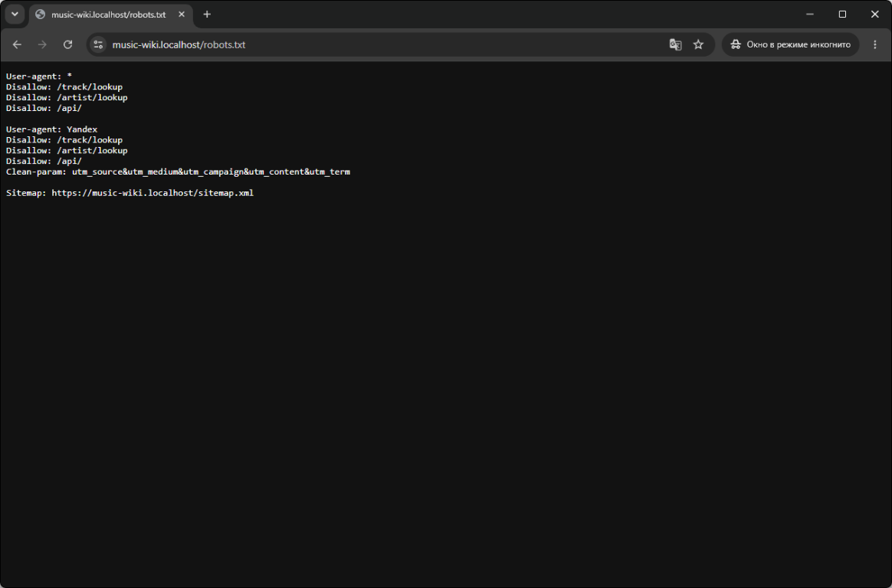

### 8.2. Доступность прогресс-бара

На странице артиста у блока `role="progressbar"` не было доступного имени. Lighthouse снижал Accessibility до 98. В шаблоне `_macros.html` добавлен `aria-label="Совпадение {{ percent }}%"`. После исправления повторный Lighthouse дал Accessibility 100.

Было: Accessibility 98.

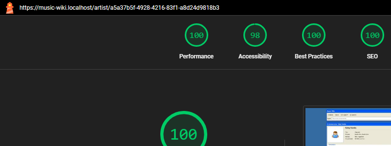

Стало: Accessibility 100.

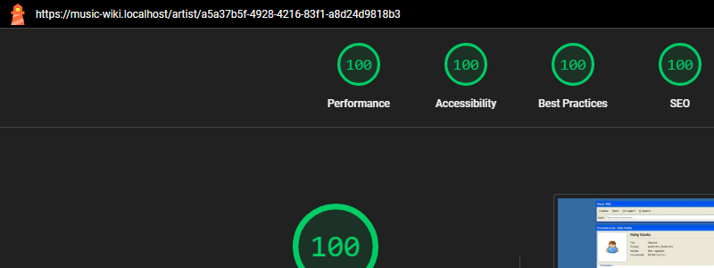

Повторный отчет: [artist-after.html](reports/artist-after.html).

### 8.3. Сохранение трека в sitemap

При открытии трека приложение передавало в `tracks` ссылку на альбом, которого еще не было в таблице `albums`. Supabase отклонял запись по внешнему ключу, и трек не попадал в sitemap. Теперь ссылка на альбом добавляется только после проверки, что альбом уже сохранен. После исправления трек появился в sitemap.xml.

Было: 3 адреса в sitemap.xml.

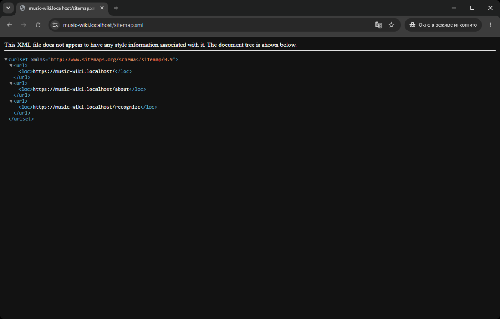

Стало: 6 адресов, включая карточку артиста и две карточки треков.

### 8.4. Проверка распознавания через AudD

В `.env` были добавлены ключи внешних сервисов: `LASTFM_API_KEY`, `AUDD_API_TOKEN` и `MB_CONTACT`. Старый токен AudD сервис считал неактивным, после замены токена распознавание заработало. Проверка выполнялась на локальном стенде: на страницу `/recognize` загружен тестовый аудиофайл, AudD вернул исполнителя `Tears For Fears` и трек `Everybody Wants To Rule The World`. Приложение открыло карточку `/track/14379ff4-5128-4e0f-8d08-1a4e50f53187`. Карточка сохранилась в Supabase и появилась в sitemap.xml, поэтому адресов стало шесть.

После исправлений:

- `/search` и `/random` не закрыты в robots.txt, но остаются `noindex`;
- страница артиста имеет Accessibility 100;
- артист и два трека входят в sitemap.xml;
- повторный Lighthouse на `/` дал Performance 100, Accessibility 100, Best Practices 100, SEO 100;
- `python -m pytest -q` - 19 passed.

## 9. Что осталось неисправленным

1. Один запуск страницы трека дал LCP 4,1 с из-за внешней обложки Last.fm. Медиана трех запусков равна 100, но для стабильности обложки нужно кэшировать или проксировать их на своей стороне. Это отдельная задача.
2. Адаптивность проверена в эмуляции 400 px. На реальных устройствах с другими размерами экрана проверка не проводилась.
